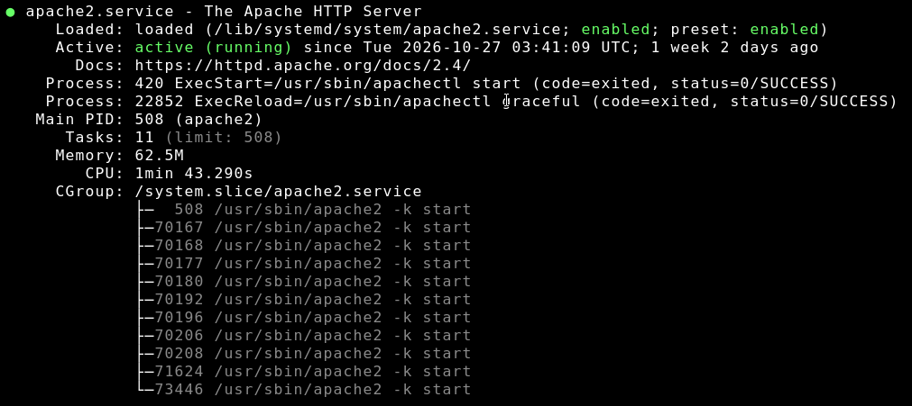

# Install and Configure Debian 12 Server with Apache2/Virtual Hosts/HTTPS on Amazon Lightsail

**Date:** September 2026  
**Networking and Security Domain:** Server Administration  
**Tools and Hardware Used:** Amazon AWS Lightsail, Apache2, Certbot, SSL, SSH, DNS

## 1. Scenario and Objective

A desire to escape my internet hosting provider's constantly escalating prices and reduced services led me to a decision to prepare my own server to self-host the applications and data I was using.

## 2. Architecture and Design

I chose to run my server on Amazon Lightsail and provisioned an instance of the Debian 12 LAMP stack. I chose small, lightweight virtual hardware to begin with, knowing that the Amazon services are scalable. Currently the server has 512 MB RAM, 2 vCPUs, 20 GB SSD.

## 3. Methodology and Execution

**Initial Assessment**
* The image installed easily using Amazon's built in tools and it was running with SSH access and completed basic configuration tasks and verification that expected services were running correctly (Apache2, MariaDB, PHP 8.4).

**Configuration/Execution**
* One of my goals was to learn how to configure virtual hosts with Apache. My previous server was hosting around a dozen of my websites and projects, each with a different domain name and subdomains. I wanted to replicate that here. I configureed virtual hosts to do this and prepared for three websites with their own domains. I will add more as I complete the migration to this new server.
* I wanted HTTPS everywhere so I learned how to use Certbot to install Let's Encrypt certificates into Apache. When writing the virtual host configurations I included HTTPS redirect to force the use of encryption for web visitors. I manually update the certificates now when needed since I have wildcard certificates that are more difficult to update automatically. Eventually I may look into an automated way of doing this.
* At this point the server was ready to begin the application and data migrations, which will be covered in other project pages.

## 4. Challenges and Troubleshooting

**SSL Certificate Renewal.** The first time the SSL certificates came up for renewal I thought they were going to renew automatically. I realized the two days left that they would not. I had to research why they did not appear they were going to renew and how to do it manually with Certbot.
* **Troubleshooting.** Discovered that manual renewal was necessary because I was using wildcard certificates for the domains. Had I not been using wildcards, the certificates for individual domains could have been renewed automatically.
* **Resolution.** Went through the renewal steps for manual renewal with Certbot. Viewed the new certificates to ensure that the expiration dates had actually changed.

## 5. Conclusion

**Final Outcome.** The Lightsail Server has been running for two months with the only downtime being a couple restarts for kernel updates. Regular maintenance includes applying security patches when needed. For instance, the recent PHP vulnerability was patched immediately.

*Caption: Apache server running on Debian 12 Amazon Lightsail instance.*
